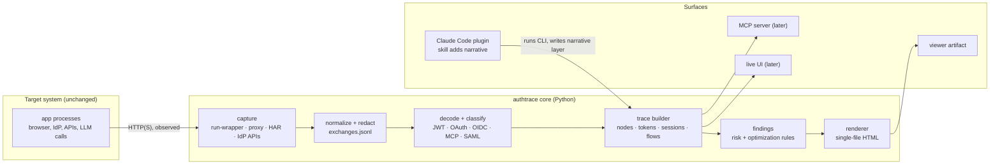

# authtrace: handoff plan

**Working name:** `authtrace` (unconfirmed, see [Kickoff decisions](#17-kickoff-decisions))
**Written:** 2026-10-03, at the end of a memes-agent learning-checkpoint session
**For:** a fresh Claude Code session in a new, empty repo
**Status:** planning only. Nothing is built yet, and no repo was changed to produce this plan.

> **Merged into visualizer, 2026-10-10.** authtrace now lives in the `visualizer` plugin as the
> `/visualizer:auth-flow` and `/visualizer:explain-token` skills, with a stdlib-only core in
> `lib/authtrace/`. This reverses §17 decision 5. §14's repo layout and stack (uv, Python 3.13,
> `src/`, pytest) and §19's kickoff prompt are superseded. See [`../decisions.md`](../decisions.md).
> The rest of this plan (capture, trace model, confidence, findings, UI, milestones) still stands.
> Reference scripts in `reference/` read dev passwords from the environment instead of hardcoding them.

---

## 0. TL;DR

A tool that **watches a running system's identity and access traffic** (OAuth 2.x, OIDC, the MCP
authorization spec, and later SAML). It builds a **trace**: which nodes talk, what each hop carries,
which tokens exist, where they travel, and who checks which claim. It renders that trace as the
interactive step-through diagram from the memes-agent session, and labels every fact with how sure
it is.

**Recommendation: one Python core, with a Claude Code plugin as the first surface.**

| Layer | What it is | Why |
|---|---|---|
| **Core** (`authtrace` Python package + CLI) | Capture, normalize, decode, classify, find risks, render. Deterministic, testable, and runs with no LLM. | Drops into any system as an external process. Every other surface reuses it. |
| **Surface 1: Claude Code plugin** (skill + bundled CLI) | Claude runs the workflow from the memes-agent session: read the code, run the flow under capture, explain anomalies from source, annotate, publish the artifact. | Learning comes from code-aware explanations ("who checks what, at which file:line"), and only an agent can write those. It also matches your `visualizer` plugin pattern and distribution. |
| **Surface 2: Trace viewer** (static single-file HTML) | The artifact UI, driven by a `trace.json`. It can also load a dropped trace or HAR file. | A link anyone can open, including the Arcade team. No install needed. |
| **Surface 3: MCP server** (built with `arcade-mcp-server`) | The core's tools exposed to any agent (Claude Desktop, Cursor, Arcade). | Dogfoods Arcade, gives you something to share with their team, and moves toward "built into the Arcade dashboard". |
| **Surface 4: Live mode** (local daemon + web UI) | Real-time capture, active sessions with expiry countdowns, replay. | The later monitoring and troubleshooting use case. |
| **Arcade dashboard** | A pitch, not a build target. | Enabled by a stable trace schema and an embeddable renderer. |

Build order: core + trace schema → viewer (port today's artifact) → plugin → proxy and browser
capture → live mode → MCP server → SAML.

---

## 1. Genesis and reference material

### What happened in the memes-agent session (2026-10-03)
In `~/Workspace/claude-code/memes-agent` (no GitHub remote yet), Claude was asked to run `tests/test_live.py`, share the logs, and build an
annotated, dynamic architecture flow diagram framed around the project's learning goals, without
changing the repo. The result is the starting point for this project.

- **Published artifact (private to you):** https://claude.ai/artifact/S5oEBNsVSoCfBmqs1aB9pV.
  In a new session, read it with the Artifact tool's `read` action. Don't use WebFetch.
- **Local copies** in `reference/` next to this file:

| File | What it is |
|---|---|
| `reference/memes-agent-flow.html` | The artifact's full source: hand-laid SVG topology, stepper, packets, step cards, token inspector, goals map, logs. **This is the v1 UI spec.** |
| `reference/live-test.log` | `pytest -m live -v -s -o log_cli=true --log-cli-level=INFO` output: 10 HTTP requests (11 INFO lines with the session-ID line), PASSED in 4.10 s |
| `reference/trace.log` | Output of the scratch tracer: token header and claims, JWKS kids, every MCP JSON-RPC message, both Claude turns, the meme, plus a no-token 401 probe and the PRM fetch |
| `reference/trace_live.py` | The scratch tracer. It wraps the project's classes from outside (an httpx event-hook subclass, a gateway subclass, an LLM subclass) with **zero repo changes**. It's the seed of the in-process capture hook (§5). |
| `reference/browser-flow/` | **Second run, same day: the full v1 flow with a real browser**, all observed. It holds three working capture scripts (`tracecommon.py`, `traced.py`, `drive.py`), the redacted event streams and merged timeline (`capture/`), and the second artifact's source. Its own `README.md` lists files, how it was run, and five known gaps. Published: https://claude.ai/artifact/3mfsQgQaabgLp4e91Qy8bc |

### The second run: browser in the loop (2026-10-03, later)
Asked for "the full v1 flow with the browser in the loop", Claude first explained that the first
artifact's Web tour was reconstructed, not observed. Then, with the user's OK, it:
1. Stopped the user's running memes-web and memes-mcp. Keycloak's registered `redirect_uri`
   pins memes-web to `:8000`, so a traced copy couldn't run alongside it.
2. Relaunched both under `traced.py` (hooks added from outside, a scratch profile DB, no repo
   edits).
3. Drove headless Chrome through login → onboarding → meme → logout with `drive.py`, taking
   Keycloak admin-API session snapshots at four moments.
4. Merged the three streams, explained them, published a new artifact, and shut its servers down.
   The user restarts their own.

It **corrected a claim in the first artifact.** authlib keeps the PKCE `code_verifier` in
Starlette's session, which is the browser's signed (readable) HttpOnly cookie, so the browser *does*
hold the verifier. Reconstructed narratives get facts like this wrong, which is the argument for
observed capture plus the confidence model (§7). Its findings feed §5, §9, §13 and Appendix A2.

### The procedure that produced the artifact
"Work exactly as it did" means the plugin skill has to reproduce these steps. Each one is a
requirement.

1. **Read the project's own context first:** CLAUDE.md, the README architecture section,
   `docs/decisions.md`, and learning notes. These provide the components, the **invariants** (which
   became checks and callouts) and the **learning goals** (which became the G1–G5 filters).
2. **Read the code on the request path:** `tools.py`, `loop.py`, `llm.py`, `web.py`, `auth.py`,
   `server.py`, `catalog.py`, `store.py`, `config.py`.
3. **Check that dependencies are up:** Keycloak discovery returned 200, the MCP server returned 401
   with no token, and the API key was present (checked by count only; the value was never read).
4. **Run the flow with request logging on.** That gave the 10 HTTP requests in the raw log.
5. **Run it again under a tracer that sees payloads,** wrapping the code from outside with the
   tokens redacted.
6. **Explain every anomaly from the source.** The 400 on the first `POST /mcp` was traced into
   `arcade_mcp_server/transports/http_session_manager.py` (unsupported protocol version `2026-07-28`
   → fallback to `2025-11-25`). Reading `resource_server/middleware.py` proved the token was
   validated *before* that check. Reading `validators/jwks.py` gave the JWKS cache TTL (3600 s).
7. **Explain claims from config:** the realm JSON showed that the `memes:read` client scope
   carries the audience mapper that sets `aud`.
8. **Run an extra probe (opt-in):** no token → 401 + `WWW-Authenticate: resource_metadata=…` →
   the PRM document names the authorization server.
9. **Build the narrative:** steps, each with what crossed the wire, who checks what, OAuth roles, the
   invariant involved, file:line refs, and a "check yourself" question.
10. **Separate observed from reconstructed.** The Live tour was observed. The Web tour was rebuilt
    from code and labeled that way. Facts that weren't seen (the JWKS fetch was likely cached) were
    labeled "first request only, then cached". This is the seed of the confidence model (§7).
11. **Publish** as a private artifact, and share the raw logs in chat.

### Your genesis notes, mapped to this plan

| Note | Where it lands |
|---|---|
| Map of app + network topology, focused on identity and access | §4 architecture, §6 trace model (nodes, boundaries, roles) |
| Real-time: origin, what happens at each node, what each edge carries | §5 capture, §11 live mode |
| Sessions in real time: cards with live expiry countdowns and token fields | §6 `sessions` / `tokens`, §11 sessions panel |
| Replay to step through an auth flow | §11 stepper + timeline (exists today) |
| Highlight OAuth vs OIDC | §10 protocol lenses |
| Extensible for SAML | §8 decoders (SAML is a family), M8 |
| Dogfooding to learn first; monitoring later | §15 milestones double as lessons; live mode in M6 |
| Risks and optimizations | §9 findings rules |
| Could be built into the Arcade dashboard | §3 surfaces, §15 M7+ |
| Third-party systems: assume from what's visible, and flag what isn't known for sure | §7 confidence model, which runs through every layer |

---

## 2. Goals and non-goals

### Goals
1. **Teach.** Make OAuth, OIDC, MCP auth and SAML visible on *your own* running systems. Every step
   explains what happened, who checked what, and why, with links to the code and specs.
2. **Drop in anywhere.** Never modify the target system. Capture from outside: a process wrapper,
   a proxy, HAR import, IdP admin APIs.
3. **Be honest about certainty.** Every fact carries provenance: observed, decoded, verified,
   declared, inferred or unknown. Gaps are drawn, not hidden.
4. **Leave something behind.** A trace plus a viewer link that someone else can open and
   understand, such as the Arcade team.
5. **Grow into observability:** live sessions, findings and troubleshooting, without a rewrite.

### Non-goals (for now)
- Not a general APM or packet sniffer. HTTP(S) identity and access traffic only.
- Not a penetration-testing tool. Active probes are opt-in and only against systems you own (§13).
- Not a hosted service. Everything runs locally, and captures never leave the machine unless you
  publish a redacted artifact.
- No React or build step for the UI in v1. Keep today's vanilla HTML/JS.

---

## 3. Target surface: options and recommendation

| Criterion | CC plugin (+ core) | Standalone CLI/daemon | MCP server | Arcade dashboard | Browser extension | Viewer artifact only |
|---|---|---|---|---|---|---|
| Reproduces today's code-aware explanations | **Yes** (Claude reads the code) | No | Partly (needs an agent driving it) | No | No | No |
| Drops into any system without changes | Yes (via core) | **Yes** | Yes (via core) | Only Arcade-hosted flows | Browser hops only | Needs a capture from elsewhere |
| Back channel (server→server) visible | Yes | Yes | Yes | Partly | **No** | Depends on input |
| Works without an LLM | Core does | **Yes** | Yes | Yes | Yes | Yes |
| Live monitoring | Via core daemon | **Yes** | Poll-based | Yes | Yes | No |
| Shareable with the Arcade team | Plugin marketplace + viewer link | pip/uvx | **Any MCP host; deployable to Arcade** | n/a | Store review | **Just a link** |
| Effort to first useful version | **Low–medium** (pattern exists in `visualizer`) | Medium | Medium | Not yours to build | High | Low (but limited) |
| Fit with your existing work | **`visualizer` plugin, uv/ruff/pytest** | Good | **arcade-mcp-server** | — | — | Today's artifact |

**Decision (recommended):** the core is the product. The plugin is the first surface because the
learning value comes from Claude reading code, and only the plugin delivers that. The viewer comes
free with the renderer. The MCP server is the second agent surface and the Arcade bridge. Live mode
is a core feature exposed as a CLI command (`authtrace live`).

Why not MCP-server-first: an MCP server gives an agent tools but not the *procedure* (§1). A Claude
Code skill carries the procedure, and a plugin can bundle an MCP server later
(`.mcp.json` in the plugin), so nothing is lost by starting with the plugin.

---

## 4. Architecture



**The split that matters:** the deterministic core produces *facts* (exchanges, decoded tokens,
roles inferred by rules, findings). Claude produces *narrative* (what/why text, "who checks what"
from code, quizzes, goal tags), written into a separate `narrative` section of the trace. The
renderer merges them. The same core works without Claude, and Claude's prose can never silently
overwrite an observed fact.

This mirrors `visualizer`: "Claude does the reasoning; `viz.py` does the deterministic parts, and it
validates the model (ids, references, evidence paths that exist, a secret lint)." Reuse that
discipline: an `authtrace check` command validates the trace (schema, references, that evidence
paths exist, and a secret/token lint) before rendering.

---

## 5. Capture strategy

No single mechanism sees everything. Offer several, and record in the trace which one saw each
exchange.

| Mechanism | Sees | Doesn't see | Setup | Milestone |
|---|---|---|---|---|
| **`authtrace run -- <cmd>`, in-process hooks (Python)** | Every httpx/requests/aiohttp call the process makes, before TLS, with bodies. This is how today's tracer worked. | Other processes; the browser | None. It injects a `sitecustomize` via `PYTHONPATH` that patches HTTP clients' send paths. No repo edits. | M2 |
| **`authtrace run`, proxy env** | Calls from any language that honors `HTTP(S)_PROXY` | Clients that ignore proxy env, and loopback calls those clients exempt | Sets `HTTP_PROXY`, `HTTPS_PROXY`, `NO_PROXY=""`, plus CA vars (`SSL_CERT_FILE`, `REQUESTS_CA_BUNDLE`, `NODE_EXTRA_CA_CERTS`; Node also needs `NODE_USE_ENV_PROXY=1` on recent versions, **verify**) | M5 |
| **Forward proxy (mitmproxy as a library)** | Back channel across languages; HTTPS once the CA is trusted | Pinned-cert clients | Local CA, trusted per runtime | M5 |
| **Browser via Playwright through the proxy** | Front channel: redirects, `/authorize`, callback, cookies | — | Chromium (`PLAYWRIGHT_BROWSERS_PATH` is preset in Claude cloud environments) | M5 |
| **HAR import** | Front channel from a real browser (DevTools → Save as HAR) | Back channel | None | M2 |
| **IdP admin/event APIs** (Keycloak first) | AS-side truth: user and client sessions, login and token events | Wire payloads | Admin credentials (dev realm), events enabled | M6 |
| **Log ingestion** (e.g. the `memes-mcp` "make_meme user=…" line) | Server-side decisions the wire doesn't show | — | Point at a file or a process's stdout | M6 |
| **OpenTelemetry import** | Timing and topology in systems that already emit spans | Usually headers and bodies | OTLP file/collector | Later |

### Gotchas to design for (from this project)
- **Don't reverse-proxy by changing URLs.** Rewriting `localhost:8080` to a proxy port breaks `iss`
  and `aud` exact-match checks (memes-agent's `localhost` vs `127.0.0.1` lesson). Prefer forward
  proxying or in-process hooks, which leave URLs untouched.
- **Already-running services aren't captured** unless they're started under `authtrace run` or
  through the proxy. In the session, `memes-mcp`'s JWKS fetch was invisible for this reason. The
  trace must show that edge as `inferred` or `declared` (from code), not drop it.
- **Loopback and proxies:** many clients skip the proxy for `localhost`. Detect missing expected
  traffic and say so ("no exchanges seen from process X; is it honoring the proxy?").
- **Keycloak cookies are `Secure`.** Browsers accept them on `http://localhost`, but Python cookie
  jars won't send them over http. Scripted browser flows must use a real browser (Playwright) or
  drop the flag (memes-agent handoff note).
- **Streaming responses** (MCP's GET event stream, LLM streaming): record headers and chunk
  timing, and don't block on reading the body. The tracer only read bodies for statuses ≥ 400 for
  this reason.
- **Hook below the auth flow** (learned in the browser run). Patching `httpx.AsyncClient.send` sees
  the request *before* httpx applies `auth=`, so authlib's `client_secret_basic` header was never
  captured. The in-process hook should wrap the transport (`AsyncHTTPTransport.handle_async_request`
  for httpx/httpx2) to record the final wire request, and tee streamed bodies there.
- **Cookies ignore ports.** On `localhost`, memes-web's `session` cookie, verifier included, is
  sent to Keycloak on `:8080`. Expect same-host dev setups to cross-pollinate cookies, and flag it
  (§9 `COOKIE-HOST-SHARING`).
- **Servers you didn't start:** the browser run solved this by stopping and relaunching them under
  the tracer, with consent. `authtrace run` should offer "restart X under capture", and warn when a
  registered `redirect_uri` pins a port.
- **Servers you didn't build** (e.g. an `MCPApp` that builds its own ASGI app) may have no
  injection point for an inbound logger. Wrap known library seams (`validate_token`,
  `_fetch_jwks`), or fall back to the proxy.
- **Browser without a download:** Playwright's `channel="chrome"` drives the installed Chrome. It
  was run through `uvx --with playwright`, so the target's lockfile stays untouched.

---

## 6. Trace model v0 (the contract)

One JSON document per capture: `trace.json`, plus an append-only `exchanges.jsonl` during live
capture. Version it from day one (`schema_version: 0` until M4, then 1). The shape maps directly
onto the data already hard-coded in `reference/memes-agent-flow.html` (`LIVE`, `WEB`, `TOURS`,
`CLAIMS`, `GOALS`). Porting the artifact is mostly "read this JSON instead".

```jsonc
{
  "meta": { "schema_version": 0, "tool": "authtrace", "captured_at": "...", "target": "memes-agent",
            "command": "uv run pytest -m live", "mechanisms": ["run-hooks"], "redaction": "dev" },
  "boundaries": [ { "id": "machine", "name": "Your machine", "token_zone": true } ],
  "nodes": [
    { "id": "kc", "name": "Keycloak", "kind": "authorization-server",
      "roles": ["authorization-server", "openid-provider"], "boundary": "machine",
      "parent": null, "endpoints": ["/auth", "/token", "/certs"], "holds_tokens": false,
      "evidence": ["infra/keycloak/memes-realm.json"], "confidence": "declared" }
    // kinds: user-agent, client, agent-module, authorization-server, resource-server,
    //        llm-api, upstream-idp, datastore, gateway, unknown
  ],
  "edges": [ { "id": "gw-mcp", "from": "gateway", "to": "mw", "label": "JSON-RPC + Bearer",
               "channel": "back", "dashed": false } ],
  "exchanges": [
    { "id": "x3", "t0": 0.106, "t1": 0.108, "from": "gateway", "to": "mcp",
      "method": "POST", "url": "http://127.0.0.1:8001/mcp", "status": 400,
      "req": { "headers": {...redacted...}, "body": {...} }, "res": {...},
      "class": { "family": "mcp", "op": "server/discover", "spec": ["MCP 2026-07-28"] },
      "tokens": [ { "token": "t1", "where": "header:authorization" } ],
      "seen_by": "run-hooks", "confidence": "observed" }
  ],
  "tokens": [
    { "id": "t1", "type": "access", "format": "jwt", "fingerprint": "sha256:NSvM…",
      "issuer": "...", "audience": ["http://127.0.0.1:8001/mcp"], "subject": "95689752-…",
      "client": "memes-dev", "scope": ["openid","email","memes:read","profile"],
      "iat": 1791005772, "exp": 1791006672, "header": {"alg":"RS256","kid":"NSvM…"},
      "claims": {...}, "verified": false, "first_seen": "x1", "seen_in": ["x1","x3","x5"] }
    // types: access, id, refresh, code, pkce-verifier, session-cookie, saml-assertion, api-key
  ],
  "sessions": [ { "id": "s1", "layer": "sso|client|app", "subject": "...", "client": "...",
                  "started": "...", "expires": "...", "source": "idp-admin-api|observed|inferred" } ],
  "checks": [ { "at": "mw", "what": "aud == CANONICAL_URL", "evidence": "server.py:37",
                "confidence": "declared" } ],
  "findings": [ { "rule": "OAUTH-ROPC", "severity": "info", "title": "Password grant in use",
                  "exchanges": ["x1"], "detail": "...", "fix": "...", "confidence": "observed" } ],
  "flows": [ { "id": "live", "name": "Live test run", "steps": ["st1","st2"],
               "dim_nodes": ["browser"], "dim_edges": ["br-web"], "banner": "" } ],
  "narrative": {                       // written by Claude (plugin), never by the core
    "goals": { "1": ["OAuth roles", "Map resource owner, client, AS and RS onto running code."] },
    "steps": [ { "id": "st3", "title": "...", "exchanges": ["x3"],
                 "segs": [["gw-mcp", 1, "discover + Bearer", "tok"], ["gw-mcp", -1, "400", "err"]],
                 "nodes": ["gateway","mw","sess"], "what": "<md>", "wire": "...",
                 "checks": [["Middleware","token valid → pass through"]],
                 "inv": "...", "note": "...", "roles": "...", "goals": [3],
                 "code": ["src/memes_agent/tools.py:38"], "quiz": ["Q", "A"],
                 "confidence": "observed" } ]
  },
  "layout": { "positions": { "kc": [540, 40, 210, 166] } }   // optional manual overrides
}
```

Rules:
- **Token values are never stored.** Use a fingerprint (a hash prefix), decoded header and claims,
  and a mask such as `eyJhbGciOiJS…(redacted)`. Raw capture is a separate opt-in (§13).
- **Every fact carries `confidence`** (§7). Narrative steps inherit the lowest confidence of the
  exchanges they cite, unless Claude cites code evidence that raises it to `declared`.
- **Ids are stable** across re-runs of the same flow (derive them from role + order), so diffs and
  replays line up.

---

## 7. Confidence and provenance model

Your note: "for third-party systems … assumptions are made … highlights where it doesn't know
something for sure." This is the tool's signature feature, so it applies everywhere.

| Level | Meaning | Example from memes-agent | Drawn as |
|---|---|---|---|
| `observed` | Seen on the wire or in a log | `POST /mcp → 400`, body text | Solid |
| `decoded` | Derived deterministically, not trusted | JWT claims base64-decoded | Solid, "decoded" tag |
| `verified` | Cryptographically checked by authtrace | Signature checked against the fetched JWKS (`kid NSvM…`) | Solid + check mark |
| `declared` | Stated by config, metadata or code, with an evidence path | `expected_audiences=[CANONICAL_URL]` in `server.py`; PRM `authorization_servers` | Solid, evidence link |
| `inferred` | Heuristic or LLM reasoning; show the reasoning | "JWKS fetched once, then cached" (from `cache_ttl=3600`, not seen) | **Dashed** + "inferred" |
| `unknown` | An explicit gap | A third-party RS accepted the token; how it validated is not visible | Hatched + "?" with what would resolve it |

Rules:
- Inference must say *why* ("returned 401 with `WWW-Authenticate: Bearer` → acts as a resource
  server") and *what would confirm it* ("enable capture on process X", "point at its source").
- Role assignment for third-party hosts is rule-based first (status codes, headers, paths matching
  discovery metadata, `.well-known` documents), then LLM-refined. Both are labeled `inferred` until
  evidence upgrades them.
- The viewer gets a "Show certainty" toggle that tints the whole diagram by confidence, so the
  unknowns stand out.

---

## 8. Protocol decoders and classifiers

Family registry. Each decoder takes an exchange and returns `{family, op, spec refs, extracted
tokens, facts}`. The registry is pluggable (`# EXTEND:` point).

| Family | Recognize by | Extract | Spec refs |
|---|---|---|---|
| OAuth token endpoint | `POST …/token`, `grant_type=` | Grant type (`authorization_code`, `password`, `client_credentials`, `refresh_token`, token-exchange), client auth method, PKCE verifier present, issued tokens, `expires_in`, `refresh_expires_in` | RFC 6749, 7636, 8693, OAuth 2.1 draft |
| OAuth/OIDC authorize | `GET …/auth(orize)` with `response_type` (often a front-channel 302) | `client_id`, `redirect_uri`, `scope`, `state`, `nonce`, `code_challenge(_method)`, `prompt`, `resource` | RFC 6749, 7636, 8707, OIDC Core |
| Callback | 302 to `redirect_uri?code=&state=` | Code (masked), state match | RFC 6749 |
| Discovery | `/.well-known/openid-configuration`, `/.well-known/oauth-authorization-server` | Endpoints, algs, supported grants → **declared** node facts | OIDC Discovery, RFC 8414 |
| JWKS | `jwks_uri` / `…/certs` | kids, algs, `use` → enables `verified` | RFC 7517 |
| Protected Resource Metadata | `WWW-Authenticate: … resource_metadata=` → `/.well-known/oauth-protected-resource…` | `resource`, `authorization_servers` → RS↔AS edge (**declared**) | RFC 9728, RFC 6750 |
| Bearer use | `Authorization: Bearer` on any request | Which token, to which audience; does `aud` match the destination? | RFC 6750 |
| UserInfo / introspection / revocation | Paths from discovery | Claims, `active` | OIDC Core, RFC 7662, 7009 |
| Logout | `end_session_endpoint`, `id_token_hint`, front/back-channel logout | Session end | OIDC RP-Initiated Logout |
| MCP | JSON-RPC body with `method` (`initialize`, `server/discover`, `tools/list`, `tools/call`, `notifications/*`), `Mcp-Session-Id`, `MCP-Protocol-Version` | Session lifecycle, tool names and args (redactable), protocol negotiation | MCP spec (authorization + transport) |
| LLM API | `api.anthropic.com/v1/messages` (others later) | Tool schemas, `tool_use`, `tool_result`, `stop_reason`; **scan for token leakage** | — |
| Cookies | `Set-Cookie` / `Cookie` | Session cookies → `sessions` (layer `app` or `sso`), Secure / HttpOnly / SameSite flags | RFC 6265bis |
| SAML (M8) | `SAMLRequest` / `SAMLResponse` (POST: base64; Redirect: deflate + base64), `RelayState` | Issuer, Audience, Recipient, `InResponseTo`, `NotOnOrAfter`, NameID, attributes, signature presence (unverified at first) | SAML 2.0 Core, Bindings |
| Arcade (later) | `api.arcade.dev` calls from `arcadepy`; `needs_auth` responses | Authorization URL issued, user verifier flow, tool execution as `user_id` (**verify endpoint shapes against the docs**) | Arcade docs |

---

## 9. Findings: risks and optimizations (rules v0)

Deterministic rules with stable ids, severities (`critical`, `warn`, `info`, `opt`) and a fix hint.
Claude may add `inferred` findings, but rule findings are reproducible. Ship the first ten in M3.

| Id | Rule | memes-agent today |
|---|---|---|
| `TOKEN-LEAK-LLM` | A known token value (or prefix) appears in a request to an LLM API | Pass. Proves "tokens never reach the LLM". |
| `TOKEN-LEAK-BROWSER` | An access or refresh token is in a response body, URL or JS-readable cookie sent to a user agent | Pass (web flow) |
| `OAUTH-ROPC` | Password grant in use (removed in OAuth 2.1) | `info`: memes-dev, dev-only by design |
| `OAUTH-NO-PKCE` | `authorization_code` without `code_challenge`, or `plain` | Pass (S256) |
| `OAUTH-NO-STATE` / `OIDC-NO-NONCE` | Missing CSRF / replay protections | Pass (authlib) |
| `TOKEN-IN-URL` | A token in a query string or fragment (implicit flow, logs, Referer) | — |
| `JWT-ALG` | `alg: none`, or HS* used where a public client could know the key | Pass (RS256) |
| `AUD-MISMATCH` | Bearer sent to a host not in `aud` (would be rejected, or is accepted, which is worse) | Pass |
| `AT-LIFETIME` | Access token lifetime > 1 h (configurable) | Pass (900 s) |
| `REFRESH-TO-RS` | A refresh token sent to a resource server | — |
| `HTTP-TOKENS` | Tokens over plain HTTP to a non-loopback host | Pass (loopback only) |
| `HOST-ALIAS` | Same service reached as both `localhost` and `127.0.0.1` (breaks exact-match `iss`/`aud`) | `warn`-worthy teaching flag: issuer on `localhost`, RS on `127.0.0.1` |
| `COOKIE-FLAGS` | A session cookie without Secure / HttpOnly / SameSite | Check the web flow |
| `SCOPE-UNENFORCED` (inferred) | A scope is granted but no check is visible in RS code | `memes:read` (Lesson 5 territory) |
| `MCP-VERSION-FALLBACK` | Client probed an unsupported protocol and fell back | `info`: explains the 400 |
| `OPT-JWKS-PER-REQUEST` | JWKS fetched more than once per TTL | Pass (cached) |
| `OPT-TOKEN-PER-RUN` | A new token fetched per run or call when a valid one exists | `opt`: the test fetches per run (fine for tests) |
| `OPT-SESSION-PER-CALL` | A new MCP session per request | `opt`: one session per click (by design, documented) |
| `COOKIE-HOST-SHARING` | An app's cookie is sent to the AS (or vice versa) because they share a host | `warn` (dev): memes-web's `session` cookie reaches Keycloak on localhost |
| `PKCE-VERIFIER-IN-COOKIE` | The PKCE verifier or nonce is stored in a client-side (readable) session cookie | `info`: authlib + Starlette session, no server-side cache |
| `ID-TOKEN-IN-URL` | An ID token is sent through the browser in a URL (`id_token_hint`) | `info`: standard RP-initiated logout; note history and log exposure |
| `LINGERING-SESSIONS` | AS sessions created by scripts or tests outlive their use | `info`: password-grant runs leave `memes-dev` SSO sessions until the 30 min idle timeout |
| `APP-SESSION-OUTLIVES-SSO` | App cookie lifetime far exceeds the SSO session and token lifetimes | `info`: 14-day cookie vs 30/60 min SSO vs 15 min access token (handled by re-login) |

Active probes are **opt-in** and only against hosts you list (§13): no-token → expect a 401 + PRM;
wrong-`aud` token → expect a 401; expired token → expect a 401. Each one turns an `inferred` "RS
validates X" into `observed`.

---

## 10. Learning layer

- **Goals:** use the target repo's learning goals if they exist (the skill looks for them, as with
  memes-agent's `private/README.md`). Otherwise use a default set:
  - G1 OAuth roles
  - G2 tokens and claims
  - G3 resource-server protection
  - G4 front vs back channel
  - G5 OIDC identity layer
  - G6 sessions
  - G7 SAML

  Steps carry goal tags. Keep the filter chips and the goal map.
- **Protocol lenses (OAuth vs OIDC highlight):** a toggle that recolors steps and edges by family:
  - OAuth (authorization): access token, `aud`, `scope`, grants
  - OIDC (identity): `openid` scope, ID token, `nonce`, UserInfo, logout
  - MCP auth: PRM, `resource`, Bearer to MCP
  - SAML

  Each step shows spec badges (RFC numbers) that link out.
- **"Who checks what":** keep it on every step. Each check names the checker, the claim, and the
  evidence (file:line or observed behavior) with its confidence.
- **Check-yourself questions:** keep them. Claude writes them from the trace and the code.
- **Diagram-review mode (later):** you already learn by sketching a diagram and asking for a review
  (memes-agent `private/qa/02`, `04`). Upload a sketch, and Claude compares it with the observed
  trace: what's right, what's off, what's missing. Output in your Q&A format.
- **Lesson cadence:** each milestone teaches the concept it builds (§15), following the
  memes-agent pairing model. Claude scaffolds the plumbing, and you write the core pieces.

---

## 11. UI plan

**Keep (v1 = today's artifact, made data-driven):** the layout (sticky topology plus a step panel),
the visual tokens and fonts, light and dark themes, the stepper, the packets animated along edges
(amber means "an access token is on this hop"), the step card anatomy, the token inspector table,
the goals map, the raw logs, the tour switcher, the reduced-motion handling, and deep links
(`#live-3`).

**Change, in order of necessity:**
1. **Data-driven.** The renderer embeds `trace.json` in a `<script type="application/json">` and
   the page builds everything from it.
2. **Topology layout for arbitrary systems.** Today's SVG is hand-placed. Use a deterministic
   *role-column* layout:
   - left: no-token zone (user agents)
   - then: clients and agent modules
   - then: AS and RS stacked
   - right: external no-token zone (LLM APIs)

   Use boundaries as containers, parent/child nodes (endpoints inside the AS, middleware layers
   inside the RS), orthogonal edge routing, and `layout.positions` overrides that Claude or you can
   pin. Evaluate ELK.js (on jsDelivr/npm) only if the simple layout fails on the second reference
   system.
3. **Confidence styling** (§7) and the "Show certainty" toggle.
4. **Findings panel** next to the token inspector. Each finding links to its steps.
5. **Protocol lens toggle** (§10).
6. **Timeline scrubber** with real timestamps under the step dots (replay).
7. **Sessions panel (live mode):** a card per session or token with a live countdown to `exp` /
   `refresh_expires_in` / SSO idle-max, and the claims on tap. There are three layers, as in
   memes-agent `qa/03` Q5: the app session, the AS session, and the tokens.

**Two delivery modes, one template:**
- **Static (replay/share):** a single self-contained HTML file. It works as a local file and as a
  claude.ai artifact. Artifact constraints apply: no fetch to localhost or other hosts (CSP), scripts
  only from cdnjs/jsDelivr/unpkg, no `window.print`. So the static page can't be live. It can accept
  a dropped `trace.json`/HAR through a file input (FileReader works in artifacts).
- **Live:** `authtrace live` serves the same template from a local Starlette app and pushes
  exchanges over SSE. It binds to 127.0.0.1 only.

---

## 12. Claude Code plugin design

Mirror the `visualizer` repo layout (`.claude-plugin/plugin.json`, `marketplace.json`,
`skills/<name>/SKILL.md`, `references/`, `examples/`). Unlike visualizer's stdlib-only `viz.py`, the
core has dependencies, so skills call it with `uvx --from <plugin root> authtrace …` (or `uv run`).
uv is assumed. Record this in decisions.

### Skills
| Skill | Does |
|---|---|
| `/authtrace:trace [notes]` | The full procedure in §1, generalized. Main entry point. |
| `/authtrace:explain <token or assertion>` | Decode and explain a pasted JWT or SAML assertion: claims, who checks what, findings. Quick learning tool. Masks the input in its output. |
| `/authtrace:live` (M6) | Start live mode for a command or proxy and print the local URL. |
| `/authtrace:review-diagram` (later) | Compare your sketch with a trace. |

### `/authtrace:trace` procedure (what the SKILL.md must say)
1. **Discover:** CLAUDE.md, README, decisions, and learning notes; manifests; entry points; IdP
   config (realm JSON, etc.). Extract components, **invariants** and **goals**. Never open `.env`
   or key files; checking that a variable exists is fine (visualizer rule).
2. **Ask once, with defaults:** which flow to run (a command such as `uv run pytest -m live`, or a
   browser flow), the output directory (default `.authtrace/` in the target, gitignored, or a path
   outside the repo; **never write tracked files**), the redaction level, whether to publish an
   artifact, and whether active probes are allowed (default no).
3. **Preflight:** health-check the dependencies the flow needs (discovery URL, RS returns 401 with
   no token, required env vars present by name).
4. **Capture:** `authtrace run -- <cmd>` (plus proxy/Playwright if a browser flow is chosen).
5. **Build facts:** `authtrace build` → `trace.json` (exchanges, tokens, nodes by rule, findings).
6. **Investigate:** every non-2xx, every `inferred` node and every finding. Read the source
   (including installed libraries under `.venv/…/site-packages`) to explain it, and add `checks`
   with evidence (file:line). This step is where the 400 explanation came from.
7. **Narrate:** write `narrative` (steps, what/why, who checks what, invariants, roles, goals,
   quizzes). Mark reconstructed flows as such.
8. **Validate:** `authtrace check` (schema, references, that evidence paths exist, a token/secret
   lint over the *whole file*, confidence present everywhere). Fix until it passes.
9. **Render:** `authtrace render trace.json -o flow.html`. Look at it once if a preview is
   available.
10. **Deliver:** share raw logs in chat, then publish the artifact if agreed (private by default).
    Report anything still `unknown` and what would resolve it.

---

## 13. Security and privacy (the tool captures credentials)

- **Redaction by default** (`dev` level): token values become fingerprints plus masks.
  `client_secret`, `password`, `code`, `code_verifier`, `refresh_token`, cookies and API keys are
  masked to `first4…(len)`. Claims stay readable. `strict` (for sharing) also hashes `sub`, email
  and names, and drops bodies except the classified fields. `raw` is opt-in, local-only, with files
  at 0600 and a loud banner. **A publish always re-checks for `strict` or asks.**
- **Claims-level redaction.** Decoded token claims can carry one-time or binding values (`nonce`,
  `at_hash`, Keycloak's `state_checker`, `session_state`/`sid` in `strict`). The browser-run tracer
  masked headers, forms and URLs but left these intact inside decoded JWTs. They were masked after
  the fact in `reference/browser-flow/capture/`. The `check` lint should catch them.
- **Leak detection uses the registry, not storage:** to detect a token reaching the LLM, keep
  fingerprints of the known tokens in memory and scan outgoing bodies. Never persist raw values to
  do it.
- **Claude sees redacted traces only.** The skill works from `trace.json`, never raw captures.
- **Proxy and CA hygiene:** listen on 127.0.0.1, generate a per-install CA, document how to remove
  its trust, and never install it system-wide by default. Trust it per process through env vars.
- **Active probes:** opt-in, scoped to an allowlist of hosts in config, and limited to systems you
  own or are authorized to test. Probes never send real users' tokens to other hosts.
- **Outputs are gitignored** (`.authtrace/`). `check` fails if a trace sits inside a git-tracked
  path without being ignored.
- **The artifact is private by default.** Sharing is your call, from the Share menu.

---

## 14. Repo layout and conventions

Follow micro-agent-k / memes-agent conventions: uv, Python 3.13, `src/` layout, ruff (100 cols),
pytest with a `live` marker, `# EXTEND:` comments, `docs/decisions.md`, a CLAUDE.md with
invariants, and a private `private/` notes folder (gitignored) with lessons and Q&A.

```
authtrace/
├── .claude-plugin/{plugin.json, marketplace.json}
├── skills/
│   ├── trace/SKILL.md            (+ references/: schema.md, procedure.md, confidence.md)
│   └── explain/SKILL.md
├── src/authtrace/
│   ├── cli.py                    run | build | check | render | live | explain
│   ├── capture/                  hooks/ (sitecustomize), proxy.py (mitmproxy addon), har.py, keycloak.py
│   ├── redact.py
│   ├── decode/                   jwt.py, oauth.py, oidc.py, mcp.py, llm.py, saml.py (M8), registry.py
│   ├── model.py                  dataclasses + JSON schema for trace.json
│   ├── infer.py                  roles/nodes/edges from exchanges, with confidence
│   ├── findings/                 rules.py (one function per rule id)
│   ├── render/                   template.html (ported artifact), render.py
│   └── live/                     server.py (Starlette + SSE)       (M6)
├── tests/
│   ├── fixtures/memes-agent/     exchanges.jsonl, trace.json, expected.html (golden)
│   ├── test_decode_*.py, test_findings.py, test_render.py, test_check.py
│   └── test_live.py              (marker: live, needs a reference system running)
├── docs/{decisions.md, schema.md}
└── CLAUDE.md, README.md, LICENSE (MIT), pyproject.toml
```

Dependencies (proposed): `mitmproxy` (M5; it's large, so keep it an optional extra
`authtrace[proxy]`), `playwright` (extra `[browser]`), `joserfc` or `pyjwt` (JWT verify),
`starlette` + `uvicorn` (live, extra `[live]`), `arcade-mcp-server` (extra `[mcp]`). The core
install stays light: decode, build, check and render with near-stdlib only.

---

## 15. Milestones (each one is also a lesson)

| M | Build | Acceptance | Lesson / concept |
|---|---|---|---|
| **M0** | Repo scaffold, CI, plugin manifest, CLAUDE.md, decisions; copy `reference/` into `docs/reference/` | `uv run pytest` green; plugin loads with `claude --plugin-dir .` | Plugin anatomy; what a trace is |
| **M1** | Trace schema v0 + **renderer**: port `memes-agent-flow.html` into a template; hand-write `fixtures/memes-agent/trace.json` from the artifact's data | `authtrace render fixtures/…/trace.json` is visually and content-equivalent to today's artifact (both tours, inspector, goals, logs). Golden test. | Data-driven UI; separating facts from narrative |
| **M2** | `authtrace run -- <cmd>` with Python in-process hooks (generalize `trace_live.py` and `reference/browser-flow/traced.py`, hooking the transport, per §5); HAR import; `exchanges.jsonl`; redaction levels | Run against memes-agent `uv run pytest -m live`: captures the 10 exchanges in Appendix A with statuses and order, **including the `Authorization: Basic` header the scratch tracer missed**; no raw token or one-time claim value in any output (lint test) | HTTP clients, hooks vs proxies, what "back channel" means |
| **M3** | Decoders (JWT, OAuth, OIDC discovery, JWKS, PRM, MCP, Anthropic), token registry, rule-based node and role inference with confidence, findings v0 (ten rules), `verified` via JWKS | The memes-agent trace auto-identifies Keycloak = AS, memes-mcp = RS, test = client; `TOKEN-LEAK-LLM` passes; `OAUTH-ROPC` and `MCP-VERSION-FALLBACK` fire; JWT signature `verified` | JWT/JWS/JWKS, grant types, RFC 9728 (*you write the JWT decoder and two rules*) |
| **M4** | `/authtrace:trace` skill + `check` (schema, evidence, secret lint) + artifact delivery | In a fresh session in memes-agent, the skill produces an artifact equivalent to today's, with **zero changes to the repo** (`git status` unchanged) | Agent procedure design; provenance (*you write the procedure's investigation step*) |
| **M5** | Forward proxy (mitmproxy addon) + Playwright browser flow (generalize `reference/browser-flow/drive.py`) + CA handling | Reproduce Appendix A2 from `reference/browser-flow/capture/` with the **proxy** (not in-process hooks): the same 12 browser requests and 13 back-channel calls, the same cookie and session transitions; `OAUTH-NO-PKCE` passes and `COOKIE-HOST-SHARING` fires from real traffic | Front vs back channel, PKCE on the wire, cookies, TLS interception (*you write the PKCE/state/nonce checks*) |
| **M6** | Live mode: `authtrace live`, SSE, sessions panel with countdowns, Keycloak admin/events adapter (seed: `kc_snapshot` in `drive.py`), timeline replay; the session-layers matrix from the second artifact, made live | During a live web flow, cards appear for the app session, Keycloak SSO session, access token (900 s countdown) and refresh token; logout ends them | Sessions in three layers; token lifetimes; revocation vs `exp` |
| **M7** | MCP server surface (`arcade-mcp-server`): `trace_start`, `trace_stop`, `trace_summary`, `decode_token`, `list_findings`, `render`; bundled in the plugin; optional `arcade deploy` | Claude Desktop (or another host) can start and stop a capture and get a summary; local-only by default | MCP as product surface; Arcade framework/Engine (pairs with memes-agent Lesson 6) |
| **M8** | SAML decoders + Keycloak SAML brokering test system; more IdP adapters (Okta/Auth0/Entra logs) | A SAML-brokered login (e.g. `standup-agent`) shows AuthnRequest/Response with assertion facts, `unverified` signature labeled | SAML vs OIDC, brokering, `sub` mapping |
| **Later** | Diagram-review mode; OTel import; Arcade decoders (`needs_auth`, user verifier); `strict` share pipeline; Arcade dashboard pitch doc | — | — |

Keep M1–M4 tight. That's the "it works exactly like the session did, but anywhere" product, and
it's shareable. M5–M6 deliver most of the genesis wish list.

---

## 16. Test strategy and reference systems

- **Golden fixtures:** memes-agent exchanges → trace → HTML, with `AUTHTRACE_UPDATE_GOLDEN=1` to
  rewrite (visualizer pattern). Decoder unit tests use recorded payloads from `reference/trace.log`.
- **Lint tests:** no fixture or output may contain a raw JWT (regex `eyJ[\w-]+\.[\w-]+\.[\w-]+`),
  `client_secret` values, or API-key patterns (`sk-ant-`, `arc_`, …).
- **`live` marker:** end-to-end against a running reference system. Skipped when it isn't up.
- **Reference systems** (all yours, all local):

| System | Exercises |
|---|---|
| `memes-agent` | OAuth/OIDC with Keycloak, PKCE web flow, password grant, MCP RS with `ResourceServerAuth`, LLM leak check. **Primary golden.** |
| `standup-agent` | Keycloak OIDC + SAML via brokering, Arcade, Redis sessions (M8) |
| `arcade-test`, `live-build-agent` | Arcade Engine auth: `needs_auth`, authorization URLs, per-user tool execution (Later) |
| A third-party SaaS login (e.g. "Sign in with GitHub" in a test app) | `inferred`/`unknown` handling when you can't see the RS code |

---

## 17. Kickoff decisions

Ask these first in the new session. Recommended defaults are marked.

1. **Name.** `authtrace` (recommended, working name; check GitHub/PyPI availability), or another
   (`tokentrail`, `idflow`, `authscope`).
2. **Language/stack.** **Python 3.13 + uv** (recommended: matches your projects, mitmproxy and
   arcade-mcp are Python) vs TypeScript.
3. **Visibility.** **Public on GitHub, MIT, from day one** (recommended: easy to share with the
   Arcade team; forces the redaction discipline early) vs private until M4.
4. **First surface.** **Claude Code plugin** (recommended, §3) vs MCP server first.
5. **Relationship to `visualizer`.** Separate plugin in its own repo (recommended), with an optional
   later importer that seeds `nodes`/`boundaries` from a visualizer `architecture.json`, vs merging
   into visualizer as a second skill.
6. **Output location in target repos.** `.authtrace/` gitignored (recommended) vs always outside the
   repo. (Today's session wrote everything outside the repo.)
7. **Arcade angle.** How you want to frame it to the Arcade team: a standalone community tool that
   showcases `arcade-mcp-server` (recommended) vs a proposal for a dashboard feature from the start.

---

## 18. Project risks

| Risk | Mitigation |
|---|---|
| Capture coverage gaps (loopback bypass, pinned TLS, services not launched by authtrace) | Several mechanisms; detect *expected but missing* traffic and label it `unknown` with a fix |
| Auto-layout looks worse than the hand-tuned SVG | Role-column layout + pinned overrides; the golden test compares against today's look |
| The tool leaks the secrets it's meant to teach about | Redaction by default, fingerprint registry, whole-file lint in `check`, `strict` before publish |
| Scope creep (APM, every IdP, every protocol) | Milestone acceptance criteria; SAML and others stay behind the family registry |
| LLM narrative drifts from facts | Facts and narrative are separate sections; `check` verifies that narrative references existing exchanges and that confidence never rises without evidence |
| mitmproxy weight and install friction | Optional extra; in-process hooks cover Python targets without it |

---

## 19. Kickoff prompt for tomorrow

Paste this into the new session, started in the new empty repo directory:

> I'm starting a side project planned in `~/Workspace/claude-code/authtrace-handoff/PLAN.md`.
> Read it fully, then read `reference/memes-agent-flow.html` (the v1 UI spec) and
> `reference/browser-flow/README.md` (the second, fully observed run and its working capture scripts). The published
> version is https://claude.ai/artifact/S5oEBNsVSoCfBmqs1aB9pV; use the Artifact read action if
> you need it. Also skim `~/Workspace/claude-code/visualizer` (plugin layout and the model/check/render
> discipline) and `~/Workspace/claude-code/memes-agent` (CLAUDE.md, docs/decisions.md; it's the
> primary reference system; **don't modify it**). Start by asking me the kickoff decisions in §17,
> then do M0 only: scaffold, CI, CLAUDE.md (seed from Appendix B), decisions.md (seed from the
> decisions in this plan), and copy `reference/` into `docs/reference/`. Follow the pairing model:
> you scaffold the plumbing, and I write the core pieces during lessons.

---

## Appendix A: memes-agent golden expectations (M2/M3 acceptance)

Live test, 2026-10-03, pytest 4.10 s. Exchanges in order:

| # | t (s) | Method | URL | Status | Classification |
|---|---|---|---|---|---|
| 1 | 0.079 | POST | `localhost:8080/realms/memes/protocol/openid-connect/token` | 200 | OAuth token, `grant_type=password`, client `memes-dev` → access + ID + refresh |
| 2 | 0.106 | POST | `127.0.0.1:8001/mcp` | 400 | MCP `server/discover`, protocol `2026-07-28` unsupported (`-32600`); token **was** validated first |
| 3 | 0.109 | POST | `127.0.0.1:8001/mcp` | 200 | MCP `initialize`, `2025-11-25`, → `Mcp-Session-Id` |
| 4 | 0.111 | POST | `127.0.0.1:8001/mcp` | 202 | MCP `notifications/initialized` |
| 5 | 0.112 | GET | `127.0.0.1:8001/mcp` | 200 | MCP server→client event stream (`text/event-stream`) |
| 6 | 0.114 | POST | `127.0.0.1:8001/mcp` | 200 | MCP `tools/list` → `Memes_MakeMeme` |
| 7 | 0.117→1.784 | POST | `api.anthropic.com/v1/messages` | 200 | LLM turn 1 → `tool_use` (no token in body) |
| 8 | 1.785→1.791 | POST | `127.0.0.1:8001/mcp` | 200 | MCP `tools/call` → `trade-offer`, `matched_hint: null` |
| 9 | 1.808→3.036 | POST | `api.anthropic.com/v1/messages` | 200 | LLM turn 2 → `end_turn` |
| 10 | 3.037 | DELETE | `127.0.0.1:8001/mcp` | 200 | MCP session end |
| (probe) | — | POST | `127.0.0.1:8001/mcp` (no token) | 401 | `WWW-Authenticate: Bearer resource_metadata=…/.well-known/oauth-protected-resource/mcp` → PRM names `localhost:8080/realms/memes` |

(The raw log shows 11 HTTP lines: these 10 exchanges plus the `Received session ID` line.)

Key facts the auto-built trace must reproduce:
- Access token: RS256, `kid NSvMXk3s…` matches the JWKS `use=sig` key; `iss` = realm URL;
  `aud` = `http://127.0.0.1:8001/mcp` (from the `memes:read` scope's audience mapper); `azp` =
  `memes-dev`; scope `openid email memes:read profile`; lifetime 900 s; `sub` =
  `95689752-4a74-4283-85ce-5ab8c57bf262`.
- The JWKS fetch by memes-mcp was **not observed** (the server was already running, and the JWKS is
  cached 3600 s). It must appear as `inferred`/`declared`, not be missing.
- No access token value appears in either Anthropic request.
- Invariants to surface as checks: identity = `sub`; tokens never reach the LLM or browser; the RS
  validates sig/`iss`/`aud`/`exp`; the user's words are data; errors are data.

## Appendix A2: browser-flow golden expectations (M5/M6 acceptance)

Second run, 2026-10-03: headless Chrome, traced memes-web and memes-mcp, scratch profile DB. Source:
`reference/browser-flow/capture/` (`timeline.txt` is the merged view). t = 0 at the first Keycloak snapshot.

| Phase | Browser (front channel) | Back channel | State change |
|---|---|---|---|
| Log in | `GET /login` → 302 to `/auth` (`S256`, state, nonce); `GET /auth` → 200 login form; `POST login-actions/authenticate` → 302 `/auth/callback?state&session_state&iss&code`; `GET /auth/callback` → 303 `/onboarding` | web: discovery (lazy, at first `/login`), `POST /token` (`authorization_code` + `code_verifier`, 7 ms), `GET /certs` (ID-token validation) | `session` cookie holds authlib state (verifier, nonce), then `{user: sub, name, email}`; `KEYCLOAK_IDENTITY` set; Keycloak SSO session `2Ckpo75D` (memes-web) created; `TokenStore.put` |
| Onboarding | `GET /onboarding` 200; `POST /onboarding` → 303 `/meme`; `GET /meme` 200 | — | `ProfileStore.save(sub, words)` |
| Meme | `fetch POST /meme` → 200 JSON (2.7 s); image from `i.imgflip.com` | web: 7 MCP requests (discover 400, initialize, initialized 202, GET stream, tools/list, tools/call, DELETE), each with `Bearer fp:9e01795c`; 2 Anthropic calls (1620 ms, 955 ms), with no token in either; mcp: **one** JWKS fetch (cache miss at the first validation, 10.8 ms), then 6 hits (about 0.2 ms each) | `TokenStore.access_token` → 899 s left; mcp log `make_meme user=<sub> … -> one-does-not-simply` (`matched_hint: nerdy`); Keycloak `lastAccess` unchanged |
| Log out | `GET /logout` → 303 to Keycloak `end_session` with `id_token_hint`; Keycloak → 302 home (no confirmation page); `GET /` 200 | — | `TokenStore.pop`; `session` cookie expired; `KEYCLOAK_IDENTITY`/`KEYCLOAK_SESSION` deleted; SSO session `2Ckpo75D` gone; the earlier `memes-dev` session `jQfHpj4K` remains |

Totals: 12 browser document/fetch requests (plus 11 assets), 13 back-channel calls (12 from web, 1 from mcp),
7 token validations. Tokens: access (RS256, `aud` = MCP URL, 900 s), ID (RS256, `aud=memes-web`, nonce, at_hash),
refresh (HS512, `aud` = issuer, 1800 s = SSO idle), and the `KEYCLOAK_IDENTITY` cookie (HS512, 36000 s). All share
`sub` and `sid 2Ckpo75D`. The client authentication on `/token` must come out as **observed** this time
(`client_secret_basic`), not declared.

## Appendix B: seed CLAUDE.md for the new repo

```markdown
# authtrace

Watches a running system's identity and access traffic (OAuth, OIDC, MCP auth, later SAML) and
renders it as an interactive, step-through trace, labeling how sure it is about every fact.
Also a learning project. See docs/PLAN.md (copied from the handoff).

## Commands
- `uv sync`; `uv run pytest -m "not live"`; `uv run ruff check . && uv run ruff format .`
- `claude --plugin-dir .` loads the plugin for one session.

## Invariants
- Never modify the target system. Capture from outside (wrapper, proxy, HAR, IdP APIs).
- Never persist raw token, secret or cookie values. Fingerprints + masks only, unless raw mode is
  explicitly on.
- Every fact carries a confidence level: observed, decoded, verified, declared, inferred, unknown.
- The core produces facts. Claude writes only the `narrative` section and never edits facts.
- Claude reads redacted traces, never raw captures.
- Active probes are opt-in and only against allowlisted hosts the user owns.
- Outputs go to a gitignored directory or outside the target repo.

## Conventions
- uv, Python 3.13, src/ layout, ruff (100 cols), pytest with a `live` marker.
- Mark add-on points with `# EXTEND:` comments. Record decisions in docs/decisions.md.
- Golden fixtures: AUTHTRACE_UPDATE_GOLDEN=1 rewrites them after intended changes.

## Pairing
Claude scaffolds the plumbing. The user writes the core pieces (decoders, rules, the skill's
investigation step) during lessons. Explain the why, and keep modules small enough to read in one
sitting.
```

## Appendix C: spec references
RFC 6749 (OAuth 2.0) · OAuth 2.1 draft · RFC 7636 (PKCE) · RFC 6750 (Bearer) · RFC 7519 (JWT) ·
RFC 7517 (JWK) · RFC 8414 (AS metadata) · RFC 8707 (resource indicators) · RFC 9728 (protected
resource metadata) · RFC 7662 (introspection) · RFC 7009 (revocation) · RFC 8693 (token exchange) ·
OIDC Core, Discovery, RP-Initiated Logout, Back-Channel Logout · MCP specification (authorization,
streamable HTTP transport) · SAML 2.0 Core and Bindings · RFC 6265bis (cookies).
