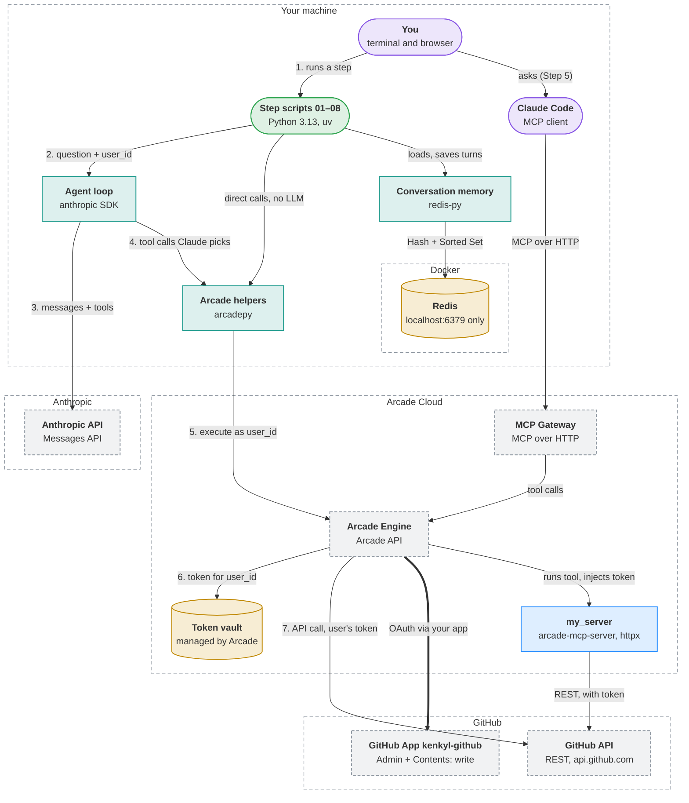
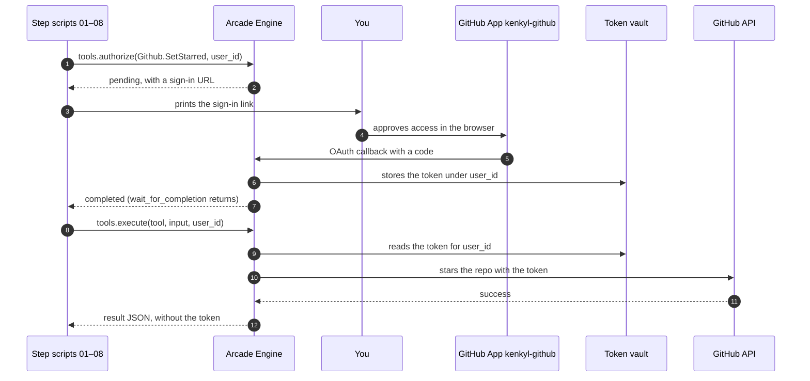
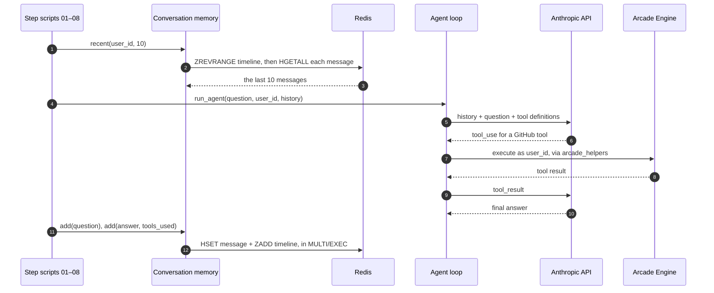

<!-- Generated by visualizer from architecture.json. Don't edit this file: edit the model, or rerun /visualizer:architecture. -->

# arcade-test architecture

A step-by-step walkthrough of Arcade.dev, in which Python scripts and Claude act on a user's GitHub account through Arcade. Claude chooses the tools and writes their arguments, and Arcade runs each one as that user after a one-time GitHub sign-in. Custom tools in my_server are deployed to Arcade Cloud, and Claude Code can use the same tools through an MCP Gateway. Step 8 adds per-user conversation memory in Redis, running in Docker on your machine.

**Highlights**

- OAuth tokens never leave Arcade: neither this code nor Claude ever sees one.
- Arcade stores every sign-in against a `user_id`, so one user can't borrow another's GitHub access.
- The code holds just two API keys, read from `.env`: one for Arcade and one for Anthropic.
- Redis has no password, so `compose.yaml` binds it to 127.0.0.1 only.
- The project's own GitHub App (`kenkyl-github`) overrides Arcade's default, so every GitHub tool signs in through it.

## Overview

| Shape | Colour | Meaning |
|---|---|---|
| Rounded box | green | Entry point: something you run |
| Rounded box | purple | Client: a person or app that uses the system |
| Box | blue | Service you run |
| Box | teal | Module inside a program |
| Cylinder | yellow | Datastore: where state lives |
| Dashed box | grey | External system you don't run |
| Dashed outline | — | Trust or deployment boundary |
| Solid arrow | — | Call or request |
| Thick arrow | — | Sign-in or credential flow |
| 1. 2. 3. before a label | — | The main path, in order |

## Components

| Component | Kind | Runs in | Responsibility | Evidence |
|---|---|---|---|---|
| **You** terminal and browser | client | Your machine | Runs each step, approves each one-time GitHub sign-in in the browser, and deploys my_server. | [`README.md`](../../README.md), [`WALKTHROUGH.md#step-2-call-a…`](../../WALKTHROUGH.md#step-2-call-a-tool-as-a-user-uv-run-02_direct_callpy) |
| **Claude Code** MCP client | client | Your machine | Acts as the agent in Step 5, using Arcade tools from the MCP Gateway with no code from this repo. | [`WALKTHROUGH.md#step-5-same-tools…`](../../WALKTHROUGH.md#step-5-same-tools-zero-code-in-claude-code) |
| **Step scripts 01–08** Python 3.13, uv Includes: 01 explore catalog, 02 direct call, 03 Claude agent, 04 custom tool call, 07 multi-user, 08 agent with memory | entrypoint | Your machine | One runnable script per walkthrough step. Steps 5 and 6 have no script. | [`01_explore_catalog.py`](../../01_explore_catalog.py), [`02_direct_call.py`](../../02_direct_call.py), [`03_claude_agent.py`](../../03_claude_agent.py), [`04_custom_tool_call.py`](../../04_custom_tool_call.py), [`07_multi_user.py`](../../07_multi_user.py), [`08_agent_with_memory.py`](../../08_agent_with_memory.py) |
| **Agent loop** anthropic SDK | module | Your machine | Sends the question and GitHub tool definitions to Claude, runs each tool call it asks for, and repeats up to 8 times. | [`agent_core.py`](../../agent_core.py) |
| **Arcade helpers** arcadepy | module | Your machine | Loads .env, builds the Arcade client, and wraps authorize-then-execute for a user_id. | [`arcade_helpers.py`](../../arcade_helpers.py) |
| **Conversation memory** redis-py | module | Your machine | Stores each user's questions and final answers, and replays the last 10 as context. | [`memory.py`](../../memory.py), [`08_agent_with_memory.py`](../../08_agent_with_memory.py) |
| **Redis** localhost:6379 only | datastore | Your machine › Docker | Holds per-user conversation memory, keyed by a short internal id. | [`compose.yaml`](../../compose.yaml), [`memory.py`](../../memory.py) |
| **Anthropic API** Messages API | external | Anthropic | Claude chooses which tool to call and writes its arguments. It never sees a token. | [`agent_core.py`](../../agent_core.py), [`pyproject.toml`](../../pyproject.toml) |
| **MCP Gateway** MCP over HTTP | external | Arcade Cloud | Serves a chosen set of Arcade tools to Claude Code at a single URL. | [`WALKTHROUGH.md#step-5-same-tools…`](../../WALKTHROUGH.md#step-5-same-tools-zero-code-in-claude-code) |
| **Arcade Engine** Arcade API | external | Arcade Cloud | Runs each user's OAuth sign-in, then executes tools with that user's token. | [`arcade_helpers.py`](../../arcade_helpers.py), [`WALKTHROUGH.md#the-one-idea-to…`](../../WALKTHROUGH.md#the-one-idea-to-hold-onto) |
| **Token vault** managed by Arcade | datastore | Arcade Cloud | Keeps each user's OAuth tokens, and your GitHub App's secret, out of reach of callers and the LLM. | [`WALKTHROUGH.md#the-one-idea-to…`](../../WALKTHROUGH.md#the-one-idea-to-hold-onto), [`WALKTHROUGH.md#the-fix-bring-your…`](../../WALKTHROUGH.md#the-fix-bring-your-own-app) |
| **my_server** arcade-mcp-server, httpx | service | Arcade Cloud | Your MCP server of custom tools, such as get_star_count and create_repo. Deployed with arcade deploy. | [`my_server/src/my_server/server.py`](../../my_server/src/my_server/server.py), [`my_server/pyproject.toml`](../../my_server/pyproject.toml), [`WALKTHROUGH.md#step-4-build-your…`](../../WALKTHROUGH.md#step-4-build-your-own-tool-optional) |
| **GitHub App kenkyl-github** Admin + Contents: write | external | GitHub | Your own GitHub App. Arcade uses it for every GitHub sign-in in the project. | [`my_server/src/my_server/server.py`](../../my_server/src/my_server/server.py), [`WALKTHROUGH.md#the-fix-bring-your…`](../../WALKTHROUGH.md#the-fix-bring-your-own-app) |
| **GitHub API** REST, api.github.com | external | GitHub | Where the actions happen: starring and creating repos, reading profiles and repo data. | [`02_direct_call.py`](../../02_direct_call.py), [`my_server/src/my_server/server.py`](../../my_server/src/my_server/server.py) |

## Where state lives

| Store | Runs in | Holds | Lifetime | Reached by |
|---|---|---|---|---|
| **Redis** | Your machine › Docker | Messages, one Hash each, in order via a per-user Sorted Set | Until cleared; kept across restarts in the redis-data volume | Conversation memory |
| **Redis** | Your machine › Docker | User index (app user id → internal id) and the id counter | Permanent | Conversation memory |
| **Token vault** | Arcade Cloud | OAuth tokens for each user_id and provider | Until the user revokes them; Arcade refreshes them | Arcade Engine |
| **Token vault** | Arcade Cloud | Your GitHub App's client ID and secret (provider kenkyl-github) | Until removed in the Arcade dashboard | Arcade Engine |

## Flows

### First tool call, with a one-time sign-in

Step 2 stars a repo as you. The first run waits for your approval on GitHub; later runs go straight to execute, because Arcade already holds the token.

### An agent turn with memory

Step 8 answers a follow-up question using your earlier turns from Redis. Only questions and final answers are stored, not tool calls.

---

Generated by visualizer from [`architecture.json`](architecture.json). Model as of commit `cc1197d` (2026-09-29). Content hash `0d44c16f8661`.
