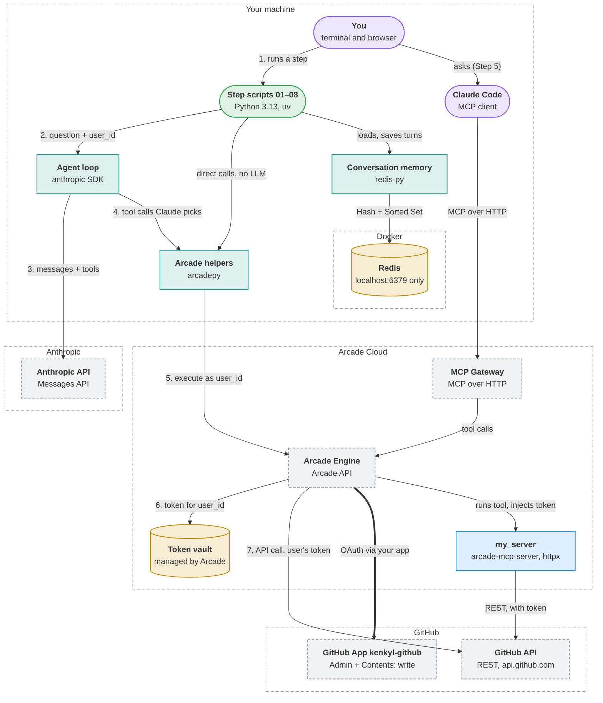

# arcade-test

A hands-on walkthrough of [Arcade.dev](https://arcade.dev), the layer that lets AI agents act in real apps (GitHub here) **on behalf of a specific user**. Arcade runs the sign-in, stores and refreshes the user's tokens, and runs the tool. Neither your code nor the LLM ever touches a credential.

Each step builds on the last:

| Step | File | What it shows |
|---|---|---|
| 1 | `01_explore_catalog.py` | Arcade's prebuilt GitHub tools: names, inputs, auth needs |
| 2 | `02_direct_call.py` | Calling a tool as a user, with the one-time GitHub sign-in (no LLM) |
| 3 | `03_claude_agent.py` (+ `agent_core.py`) | Claude picks the tools, Arcade runs them |
| 4 | `my_server/`, `04_custom_tool_call.py` | Building and deploying your own tools |
| 5 | *(no code)* | The same tools in Claude Code through an MCP Gateway |
| 6 | `my_server/` → `create_repo` | Your own GitHub App for permissions Arcade's default app lacks. This repo was created that way. |
| 7 | `07_multi_user.py` | The same tool as two users: Arcade keeps their sign-ins separate |
| 8 | `08_agent_with_memory.py` (+ `memory.py`, `compose.yaml`) | Per-user conversation memory in Redis, running in Docker |

**Start with [WALKTHROUGH.md](WALKTHROUGH.md).** It covers setup and what to look for at each step.

<!-- visualizer:start path=docs/architecture/architecture.json hash=9c3494fe6f5f -->
## Architecture



Components, data flows and where state lives: [docs/architecture/ARCHITECTURE.md](docs/architecture/ARCHITECTURE.md)
<!-- visualizer:end -->

## Quick start

```
cp .env.example .env     # add your Arcade key, Anthropic key, and user id
uv sync
uv run 01_explore_catalog.py
```

You need Python 3.13+, [uv](https://docs.astral.sh/uv/), a free Arcade account, and an Anthropic API key. Step 8 also needs Docker; `docker compose up -d` starts Redis. Use a personal or test GitHub account: Step 2 stars a repo.

## License

[MIT](LICENSE)
