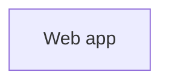

# shop

A small storefront: a web app backed by Postgres, Redis and MongoDB.

<!-- visualizer:start path=docs/architecture/architecture.json hash=000000000000 -->
## Architecture



Components, data flows and where state lives: [docs/architecture/ARCHITECTURE.md](docs/architecture/ARCHITECTURE.md)
<!-- visualizer:end -->

## Quick start

```bash
docker compose up
```

## License

MIT
