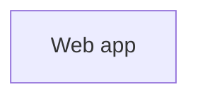

# shop

A small storefront: a web app backed by Postgres, Redis and MongoDB.

<!-- visualizer:start path=docs/architecture/architecture.json hash=000000000000 -->
## Architecture



Components, data flows and where state lives: [docs/architecture/ARCHITECTURE.md](docs/architecture/ARCHITECTURE.md)
<!-- visualizer:end -->

<!-- visualizer:data-models:start path=docs/data-models/data-models.json hash=96e05e34ae69 -->
## Data models

| Store | Engine | Entities | Main entities |
|---|---|---|---|
| **Main database** | Postgres 16.15 | 5 | `public.users`, `public.orders`, `public.order_items`, `public.paid_orders`, and 1 more |
| **Session cache** | Redis 8.10.2 | 6 | `session:{id}`, `cart:{id}`, `product:{id}`, `idx:products`, and 2 more |
| **Reviews** | MongoDB 7.0.43 | 3 | `reviews`, `recent_reviews`, `events` |
| **Code models** | Code | 2 | `OrderPlaced`, `InvoicePayload` |

Fields, keys, indexes and relationships: [docs/data-models/DATA_MODELS.md](docs/data-models/DATA_MODELS.md)
<!-- visualizer:data-models:end -->

## Quick start

```bash
docker compose up
```

## License

MIT
